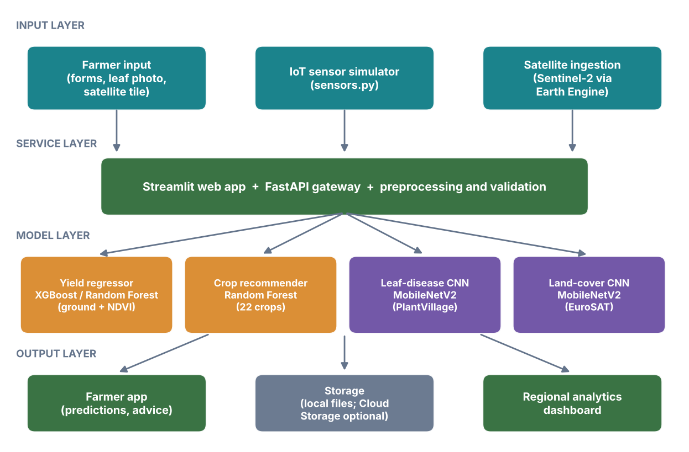
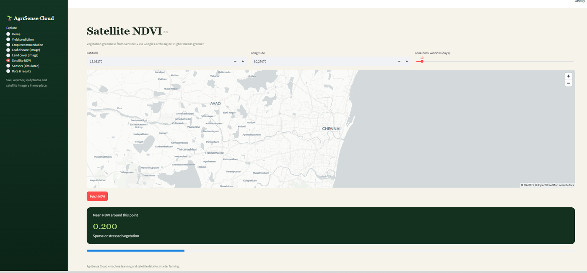
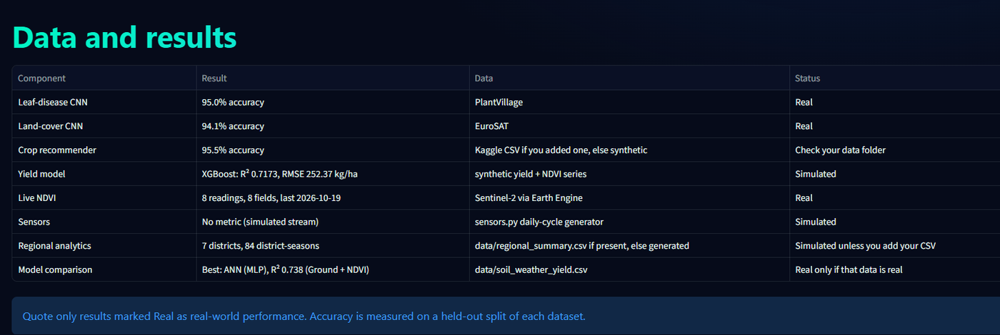

# AgriSense Cloud

**Machine learning and satellite data for smarter crop decisions.** AgriSense Cloud is a student project that brings crop-yield prediction, crop recommendation, leaf-disease detection, satellite land-cover classification, Sentinel-2 NDVI monitoring and regional analytics into one web application.

  

> **Prototype, not an advisory tool.** Parts of the data are simulated (see below) and the system has not been validated on real farms. Do not use it for real farming decisions without expert review.



## What it does

| Feature | How it works |
|---|---|
| Yield prediction | XGBoost (Random Forest as fallback) on soil, weather and NDVI features, with a what-if NDVI chart and batch CSV prediction |
| Crop recommendation | Random Forest over 22 crops from N, P, K, temperature, humidity, pH and rainfall |
| Leaf-disease detection | MobileNetV2 transfer learning on PlantVillage (38 classes) |
| Land-cover classification | MobileNetV2 transfer learning on EuroSAT Sentinel-2 tiles (10 classes) |
| Satellite NDVI | Sentinel-2 through Google Earth Engine, shown on a satellite map; a scheduled job stores NDVI for registered fields |
| Regional analytics | Yield trends, NDVI trajectories, correlations, underperforming-district analysis, disease frequency |
| Model comparison | Random Forest vs XGBoost vs ANN, with and without NDVI, 5-fold cross-validation |
| API gateway | FastAPI endpoints for all models; the web app can call them over HTTP |
| Access control | Optional password gate with signed, expiring login tokens |

## What is real and what is simulated

| Component | Data | Status |
|---|---|---|
| Leaf-disease CNN | PlantVillage images | Real data |
| Land-cover CNN | EuroSAT images | Real data |
| Live NDVI | Sentinel-2 via Google Earth Engine | Real data |
| Crop recommender | `crop_recommendation.csv` | Real only if you put the Kaggle file in `data/`; otherwise generated |
| Yield model and model comparison | Generated soil, weather, yield and NDVI series | **Simulated** |
| IoT sensors | `sensors.py` generator | **Simulated** |
| Regional analytics | Generated unless you supply `data/regional_summary.csv` | **Simulated** |

## Results

| Task | Model | Result | Notes |
|---|---|---|---|
| Leaf disease | MobileNetV2 | 95.0% validation accuracy | PlantVillage, random 80/20 split, 3 epochs |
| Land cover | MobileNetV2 | 94.09% validation accuracy | EuroSAT RGB, 22,078 train / 5,519 validation images, 5 epochs |
| Yield | XGBoost | R² 0.717, RMSE about 252 kg/ha | **Simulated data**, so not real-world accuracy |

Image accuracies come from a random validation split of benchmark datasets. They are not field performance, and the leaf model only knows the 38 PlantVillage classes: for any other plant it picks the nearest class, which is why the app warns when confidence is below 60%.

On the simulated yield data, adding NDVI features improved cross-validated R² only slightly, so a large NDVI benefit is **not** demonstrated by this repository. Testing it needs real yield data.

## Screenshots




## Quick start (Windows)

You need Python 3.10 to 3.12 (3.12.10 has a Windows installer; TensorFlow does not support newer versions), and git.

```bat
git clone https://github.com/<your-username>/agrisense-cloud.git
cd agrisense-cloud
py -3.12 -m venv venv
venv\Scripts\activate
pip install -r requirements.txt
python train_and_save.py
streamlit run app.py
```

`train_and_save.py` generates the simulated data and trains baseline models (about 30 seconds). Open http://localhost:8501.

> Run `python train_and_save.py` only once on a fresh clone. It retrains **everything**, including the image models, and refuses to run if real image models exist unless you add `--yes`. To refresh only the yield model use `python retrain_yield.py`.

### Real image models (Google Colab)
1. Open `notebooks/AgriSense_Colab_Training.ipynb` in Google Colab, select a T4 GPU and run all cells.
2. Unzip the downloaded `agrisense_image_models.zip` into `models/`.
3. Run `python merge_image_meta.py`, then restart the app.

### Real crop data
Download the Kaggle "Crop Recommendation Dataset", save it as `data/crop_recommendation.csv` with the label column named `label`, then retrain the crop model.

### Satellite NDVI (Google Earth Engine)
1. Register a Google Cloud project for Earth Engine.
2. Run `earthengine authenticate`.
3. Set `GEE_PROJECT=your-project-id` before starting the app.
4. On the **Satellite NDVI** page, register fields and click **Run ingestion now**. To collect NDVI every day, schedule `run_ingestion.bat` with Windows Task Scheduler.

### Run the API and the app together
Copy `start_all.example.bat` to `start_all.bat`, put in your own project id and password, and double-click it. It starts the FastAPI service and the web app, which then calls the models through the API. Interactive API docs are at http://127.0.0.1:8000/docs.

## Configuration

| Variable | Purpose |
|---|---|
| `GEE_PROJECT` | Earth Engine project id (needed for NDVI) |
| `AGRISENSE_PASSWORD` | Turns on the sign-in page (leave unset for no login) |
| `AGRISENSE_API_URL` | Makes the web app call the API instead of loading models itself |
| `MODEL_BUCKET`, `BQ_TABLE` | Optional Google Cloud Storage model loading and BigQuery logging |

Never commit your real `start_all.bat`, `.env` files or credentials. They are in `.gitignore`.

## API endpoints

| Endpoint | Purpose |
|---|---|
| `GET /`, `GET /meta` | Health check, class lists and saved metrics |
| `POST /predict-yield`, `/predict-yield/batch` | Yield for one field or many |
| `POST /recommend-crop` | Top crop recommendations |
| `POST /detect-disease` | Leaf photo to disease class |
| `POST /field-landcover` | Satellite tile to land-cover class |
| `GET /ndvi` | Mean NDVI around a coordinate (needs Earth Engine) |
| `GET /sensor/simulate` | Simulated sensor readings |

## Project structure

```
app.py                     Streamlit web app (all pages)
api.py, api_client.py      FastAPI service and the client used by the app
common.py, preprocessing.py, ndvi.py   Model loading, cleaning, NDVI features
train_and_save.py, retrain_yield.py, yield_models.py   Training scripts
gee_ndvi.py, ingest_satellite.py       Earth Engine NDVI and the scheduled job
sensors.py, regional.py, examples.py   Simulated data, regional analytics, example data
model_comparison.py, architecture.py   Model comparison and architecture page data
auth_token.py, cloud.py                Login tokens, optional Google Cloud helpers
notebooks/                 Colab training notebook and example-image script
INSTRUCTIONS.md            Detailed setup, Earth Engine, Colab and deployment guide
deploy/, Dockerfile        Optional Cloud Run deployment (not deployed by the authors)
tests/                     Automated tests
```

## Tests

```bat
pip install -r requirements-dev.txt
python -m pytest tests
```

The tests cover the calculation modules. `tests/test_api.py` is skipped until models are trained.

## Limitations
- Yield, sensor and regional data are simulated, and the NDVI benefit is untested on real yields.
- Image models were trained on benchmark-style images with a frozen MobileNetV2 base and few epochs.
- NDVI averages a 500 m circle around a point and depends on cloud cover.
- Cloud deployment scripts are provided but were not deployed, and no latency measurements exist.
- The password gate suits demonstrations, not hardened public use.

## Roadmap
Real district-level yield data; testing the leaf model on field photos and fine-tuning; field boundaries and NDVI heatmaps; physical sensors; cloud deployment; local-language output.

## Data and credits
PlantVillage (leaf images), EuroSAT (Sentinel-2 land-cover tiles), Copernicus Sentinel-2 imagery through Google Earth Engine, and the Kaggle Crop Recommendation Dataset. Check each dataset's license before redistributing any data. This repository does not include datasets or trained models.

## Authors
Kolani Akhila, Khandapu Shyam Satyendra, Kodamasimham Sravan, Komatla Gnaneswara Pothuraju Reddy. Guide: Mr. S. Ramadoss, Department of Computer Science and Engineering, Bharath Institute of Higher Education and Research, Chennai.

## License
MIT, see [LICENSE](LICENSE).
